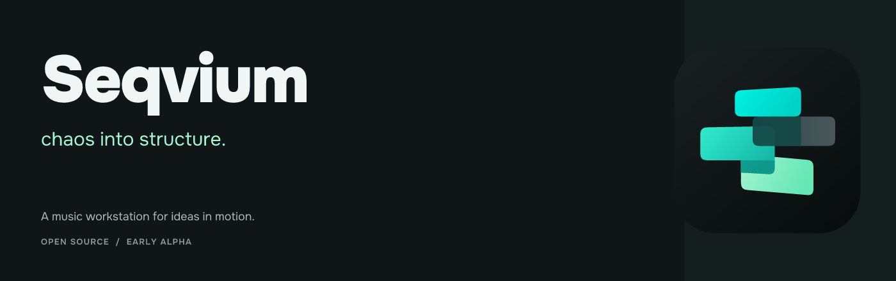
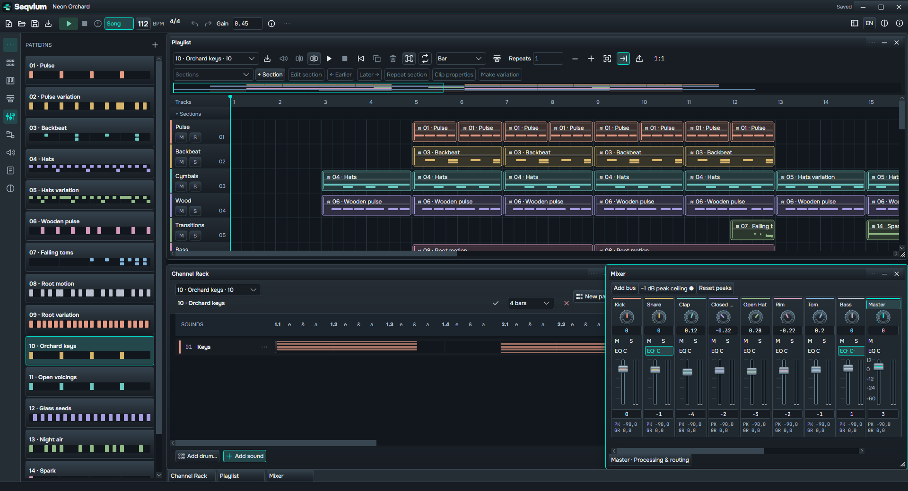
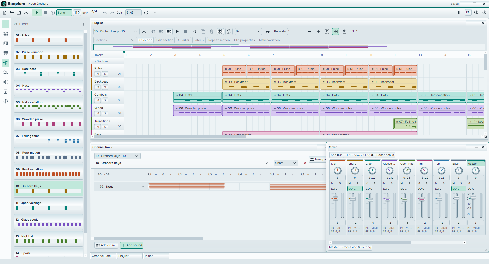

# Seqvium

Seqvium is a free, open-source desktop music workstation in early alpha. Start with a drum pattern,
a melody or an audio file, arrange it in Playlist, and mix it through shared instruments and
processing. The workflow draws inspiration from FL Studio while developing its own compact,
flexible workspace and node-based sound design.

Windows 11 is the currently tested desktop platform. This is a working alpha, not a finished
replacement for an established DAW. Linux and macOS remain architectural targets, not validated
UI/audio platforms.



<details>
<summary>Light theme</summary>



</details>

Actual application captures, using the included demo. Explore the [visual identity kit](brand/README.md)
for the logo, typography, alternative directions and publication resources.

## What you can do today

- Create your own **Kick and Clap** samples in **Sample Lab**. Generate variations, lock a useful
  characteristic, compare recent sounds, then keep them in the project or add them to Rack/Playlist.
  A PCM Rack channel can audition a candidate through its existing processing while music plays.
- Right-click a Pattern and choose **Create sample** to keep its instruments and local processing
  as reusable project audio. Find it selected in Browser, preview it, then add it to Rack or Playlist.
  The source stays editable; downstream Mixer/Master is excluded. [Resampling limits](docs/README.md#create-a-sample-from-a-pattern) apply.

- Drop **WAV, MP3 or FLAC from Windows Explorer directly onto Playlist**. Audio Clips are independent
  of Patterns and Channel Rack. See real mono/stereo waveforms, move or Ctrl-copy clips, trim their
  source ranges, split them, adjust fades and gain, and repeat the selected range at its natural speed.
- Compose in Channel Rack and Piano Roll using shared notes, pitch, duration and velocity. Patterns
  can span 1–32 bars; draw steps, melodies and chords, resize notes and audition pitches.
  Replace a shared WAV instrument from its channel menu while retaining notes, processing and Mixer routing.
- Use built-in Kick, Snare, Closed/Open Hat, Clap, Tom and Rim, editable envelopes and sound presets,
  or pitched WAV samples. Linked hats can choke each other.
- Arrange overlapping Patterns and Audio Clips together. Name/color the 32 organizational tracks,
  use track Mute/Solo, snap, zoom, overview navigation, seek and ruler-range loops.
- Name composition sections, navigate their ranges, move adjacent sections or insert a repeat with
  all their Pattern/Audio material. Mixed selections support move/copy, clipboard and exact placement.
  Make a variation of one Pattern clip for a fill or changed phrase while keeping shared instruments
  and Mixer routes. Other uses of the original Pattern keep their notes.
- Mix shared sound sources through channels, buses and pre/post sends, with level, stereo balance,
  Mute/Solo, real meters, high-pass/three-band EQ, linked compression, musical Delay, algorithmic Reverb and optional Master sample-peak
  protection. Playlist tracks do not automatically become Mixer channels.
- Edit Source → Gain → Mix → Output graphs, reuse sound editors, and arrange movable/resizable panes.
- Undo/redo musical edits, save/reopen projects with managed media, and export a Pattern or the full
  Song to 48 kHz stereo PCM16 WAV using the same audio processing.
- Open **Settings / Ctrl+,** for language, theme, global keyboard shortcuts, Browser auto preview and
  About. The title-row sun/moon opens a theme menu. Shortcut hints below describe the defaults.
- Open **Browser / Ctrl+B** to pin sample folders, browse subfolders, search names and reuse project
  audio. Browser and Patterns share a separate group at the top of the left rail; both can stay open
  beside the workspace, resize independently and restore their remembered widths.
  Inspect real waveforms, preview sounds while transport is stopped, then drag into Channel
  Rack or Playlist, or use the explicit add buttons. Preview never imports or changes Undo.
- Work in English or Russian, with Dark and Light themes.
- Explore the optional **Found Sounds** pack in Browser's **Extensions** disclosure.
  Enable or disable local sound packs; imported audio stays in your project.
- Create a fresh project with **New project / Ctrl+N**, switch playing Patterns from the navigator,
  and open a melody directly in Piano Roll. Empty documents start with one compact Channel Rack.

Audio Clips do not change pitch or speed when moved or when BPM changes. Their start positions use
musical time; their lengths, trims and fades use source frames. Clip properties offer explicit
**Time stretch (50–200%)**, keeping pitch while changing duration. It works best on sustained,
monophonic phrases; dense mixes and sharp attacks can develop artifacts. Tempo following and warp
markers are not available.
Copies reuse a source and its Mixer assignment rather than duplicating decoded audio.

Try [Sample Lab](docs/README.md#create-a-sound), [the Sample Browser](docs/README.md#find-and-use-sounds), [Audio Clips](docs/README.md#work-with-audio-clips),
[a drum pattern](docs/README.md#create-a-drum-pattern),
[a melody](docs/README.md#compose-a-melody), or [the Mixer](docs/README.md#mix-your-music).
For an editable song with licensed media, open [Neon Orchard](examples/Neon%20Orchard/README.md).
Use Save As before experimenting with the demo.

## Current limits

Playlist import accepts mono/stereo sources at 8–192 kHz. WAV supports PCM16/24/32 and float32;
MP3/FLAC import uses **Windows Media Foundation and the codecs available on that Windows installation**.
It is not a cross-platform decoder. Unsupported, corrupt or multichannel sources are rejected without
adding a clip. Channel Rack's separate WAV-sampler workflow retains its smaller 16 MiB input limit.

Audio is prepared in memory, not streamed from disk. An Audio Clip source and the unique audible
Audio Clip sources in one prepared Song are each bounded to **512 MiB of decoded float PCM**.
At 48 kHz stereo that is about 23 minutes 18 seconds for one source; higher rates allow less time,
mono allows more. Pattern-source PCM has a separate 128 MiB budget. These are preparation limits,
not a total-process memory guarantee: waveforms, old prepared states, Undo-retained media and import
temporary files also consume memory or disk. Playback shares a 32-voice budget with Patterns and
refuses overload instead of silently dropping music. Heavy system load can still cause glitches.

Audio split currently operates on a single occurrence; set repeats to one before splitting.
Section rearrangement refuses clips that cross its boundaries, shows the source/track and offers
direct navigation; explicitly split audio or adjust the section first. Dynamic track insertion,
groups, automation, external realtime plugin hosting, MIDI input, recording and crash recovery are not
implemented. Sampler pitching uses linear resampling, not time stretching. Mixer stereo pan is
balance; its peak ceiling is sample-peak protection, not true-peak mastering.

## Getting started

Install the .NET 10 SDK selected by [global.json](global.json). From a local checkout on Windows:

```text
dotnet restore Seqvium.sln --locked-mode
dotnet build Seqvium.sln -c Release --no-restore
dotnet run --project src/Seqvium.Desktop/Seqvium.Desktop.csproj -c Release --no-build --no-restore
```

The app opens an empty project and stays silent until Play or explicit Browser preview. Open Browser
from the rail to find/audition/add samples, or open Playlist from the rail to drop
audio, create a Pattern in Channel Rack, or open the included demo. Run the app with normal user
permissions: Windows blocks Explorer drops into an elevated application. No general sample library
is bundled beyond the demo's reviewed media.

Keep `Song.seqvium` and its associated `Song.seqvium.media` directory together when copying a
project. Imports create managed media, so saved projects no longer depend on the original source
file. Save As copies the required media to the new project location. Reopening never starts playback.

See the [first-use guide](docs/README.md) and [development guide](docs/DEVELOPMENT.md) for practical
steps and setup. A second launch normally brings the existing workspace forward.

## Development and contributions

The [roadmap](docs/ROADMAP.md) describes the wider direction, not a release schedule or a list of
already available features. Bug reports, musical-workflow feedback, documentation and focused code
contributions are welcome; start with [Contributing](CONTRIBUTING.md). Share only audio you have
permission to distribute, and keep private libraries out of Git.

## License

Seqvium-authored code and content use the [Apache License 2.0](LICENSE), unless explicitly identified
otherwise. Dependencies and demo recordings retain their own licenses; see
[third-party notices and provenance](docs/THIRD_PARTY.md).
