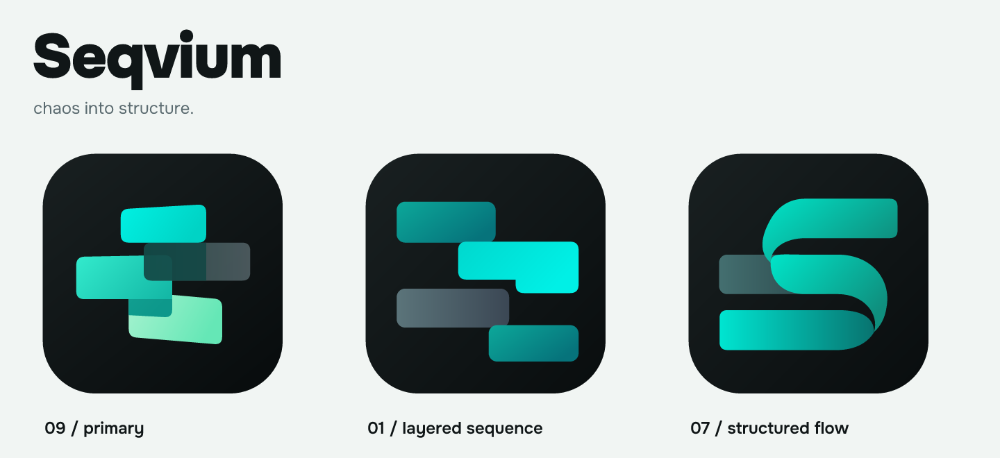
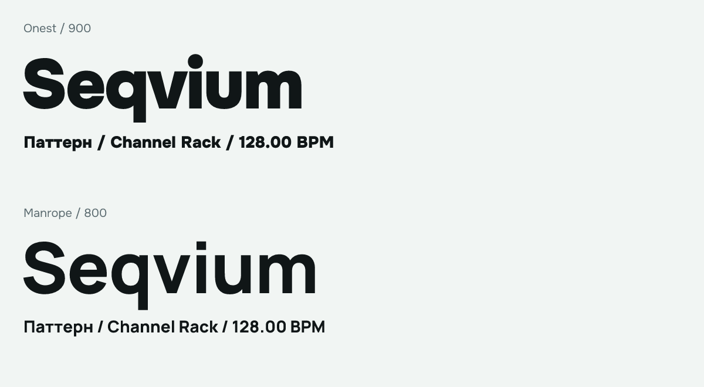

# Seqvium visual identity

**Seqvium — chaos into structure.** Musical fragments become a sequence; displaced blocks retain
the energy of making something late at night. Direction **09** is the application identity.
Directions **01** and **07** remain independently editable alternatives for future development.



## The mark

09 has four rounded fragments on a near-black chassis: an ascending cyan opening, a displaced
teal phrase, a quieter slate overlap and a descending mint ending. Opposing slopes and unequal
offsets are intentional. Preserve them when adapting the artwork. No bevel, glass shine, rainbow,
drop shadow or artificial perspective is needed to make the mark feel substantial.

The masters are manually constructed SVG paths, interpreted from the supplied raster boards.
They are new editable reconstructions, **not recovered original vectors or automatic traces**.
Their flat, restrained gradients replace the reference's stochastic grain with resolution-independent
material. Texture remains optional for future large artwork; it is absent from the shipping mark.

| Material | Location and purpose |
| --- | --- |
| Main editable masters | [09](masters/seqvium-09.svg), [small](masters/seqvium-09-small.svg), [tiny](masters/seqvium-09-tiny.svg) |
| Retained alternatives | [01 master](alternatives/01/master.svg) / [preview](alternatives/01/icon-512.png); [07 master](alternatives/07/master.svg) / [preview](alternatives/07/icon-512.png) |
| Source design references | [09](references/concept-09.webp), [01](references/concept-01.webp), [07](references/concept-07.webp), [provenance](references/manifest.json) |
| Standalone exports | [symbol](exports/symbol.svg), [app mark](exports/seqvium.svg), ink/chalk wordmarks and horizontal lockups in [exports](exports/) |
| Runtime icons | [Desktop Assets/Brand](../src/Seqvium.Desktop/Assets/Brand/): ICO and 16–1024 px PNGs |
| Fonts | [Pinned sources and hash manifest](fonts/manifest.json); [static runtime faces and licenses](../src/Seqvium.Desktop/Assets/Fonts/) |
| Publication artwork | [README header](publication/readme-header.png), [Social Preview](publication/social-preview.png), [optical review](publication/icon-sizes.png) |

The references retain the original composition and dimensions as optimized WebP. The manifest
records both original PNG hashes and retained hashes. The redundant size-comparison board stays
outside the repository. Reference-board slogans, imaginary UI, dock examples and domain names are
design context, not claims about shipped functionality, supported platforms or an owned website.

## Color and composition

The brand palette is cyan `#00E5D1`, teal `#14B8A6`, mint `#A7F3D0`, slate `#5B6B70` and ink
`#101617`, with chalk `#F1F5F3` for light publication surfaces. SVG masters own the actual artwork
colors. [HostPalette](../src/Seqvium.Desktop/Presentation/HostPalette.cs) owns UI semantic colors;
the UI is not a second copy of the artwork palette. Light uses a deeper teal action ink for contrast.

Use cyan sparingly for actions and focus. Source/channel colors, meters, transport, errors and
warnings keep their separate meanings. Dark and Light retain the same professional workspace
density and independently readable states. Do not recolor every clip or channel as a brand treatment.

Keep at least one quarter of the cyan fragment's height clear around a standalone mark/wordmark;
the app icon's outer transparent margin is part of its export. Do not crop its rounded chassis.
Use the ink wordmark on light and chalk on dark. The icon itself keeps its dark chassis in both
themes. Stretching, rotation of the complete mark, independent recoloring of fragments and aligning
away the authored offsets change the identity. Scale a complete SVG proportionally.

For small contexts, choose the target PNG rather than resizing the large export:

- 16 px: dedicated fitted master, solid fragments, simplified overlap and no slopes.
- 20–40 px: small optical master with broader separation and stronger slate contrast.
- 48–1024 px: full master with opposing slopes, layered depth and restrained gradients.

The ICO contains **16, 20, 24, 32, 40, 48, 64, 128 and 256** px independently rendered frames.
Windows EXE metadata and Avalonia's window icon consume the same ICO. Title chrome uses the small
PNG, and About uses the full mark. [ICNS](exports/seqvium.icns), SVG and PNG are prepared for future
macOS/Linux packaging; this does not establish a working package on those systems.

## Typography



**Onest Black 900** gives the wordmark its dense, rounded, open geometric character. It is a legal
visual equivalent, not an identification of the unknown lettering on the generated board.
Manrope ExtraBold 800 was visually compared and remains a retained font reference; Onest has the
closer weight, circular dot and compact rhythm for this identity. The outlined publication wordmark
uses slightly tightened spacing. Application title tracking comes from `HostMetrics`.

| Role | Face |
| --- | --- |
| Brand name | Onest Black 900 |
| Pane/section headings | Onest SemiBold 600 |
| Labels, buttons, menus, dialogs, drawn editor captions | Onest Regular 400 |
| Exact numeric fields and technical fixed-column content | JetBrains Mono Regular 400 |
| Musical symbols U+2669–U+266F, including ♯ | Explicit embedded Noto Sans Symbols subset |

All text families cover Russian and English. The music-only subset is deliberately not a text font.
Static faces are instantiated from pinned official Google Fonts source binaries, since the installed
Avalonia does not support variable fonts. No system font installation is required. Actual glyph-stream
hash checks in the [identity verifier](../tools/Seqvium.VisualCheck/IdentityCheck.cs) establish that
the renderer resolves bundled bytes, including the sharp-symbol fallback. Unusual user-entered
scripts/symbols beyond this repertoire may still use platform fallback.

Every font keeps its own complete **SIL Open Font License 1.1**, copyright and attribution.
Runtime licenses are copied beside build/publish output. [THIRD_PARTY](../docs/THIRD_PARTY.md#visual-identity-fonts-and-reference-material)
owns provenance and license boundaries. Font software retains OFL; icon geometry, publication
composition and artwork tooling use the root Apache-2.0 license.

## Reproduce the kit

Normal application builds use checked-in exports; Python is an optional artwork tool, not an app
dependency. From the repository root, create a local environment and install the small pinned toolset:

```text
python -m venv .scratch/branding-venv
.scratch/branding-venv/Scripts/python -m pip install -r tools/branding/requirements.txt
.scratch/branding-venv/Scripts/python tools/branding/prepare-fonts.py
.scratch/branding-venv/Scripts/python tools/branding/export.py
.scratch/branding-venv/Scripts/python tools/branding/verify.py
```

On macOS/Linux the interpreter is `.scratch/branding-venv/bin/python`. The two generation commands
are offline. `prepare-fonts.py --fetch` explicitly reacquires pinned upstream sources; their revisions,
file URLs, transformations and SHA-256 values are recorded in the font manifest. SVGs contain actual
paths and no system-font references or embedded raster. Export manifests record generated hashes.
Edit a master first, regenerate its derivatives, then review small icons and running UI again.

## Repository presentation

The README header and Social Preview are brand artwork, with no simulated application screenshot.
The README's workspace images are explicitly selected real captures of the bundled Neon Orchard demo.
Transient GUI checks stay in ignored `.artifacts/`; intentional publication images stay here.
Their [capture manifest](publication/captures.json) records version, project, hashes and lossless
conversion. To refresh deliberately after reviewing a successful identity run, use
`export.py --captures <successful-run-directory>`; ordinary export leaves those screenshots intact.

Upload [social-preview.png](publication/social-preview.png) in **GitHub repository → Settings →
General → Social preview → Edit → Upload an image**. The 1280×640 file is ready to upload;
changing that GitHub setting remains a separate owner action. No upload, staging, commit or push
is performed by resource generation.
